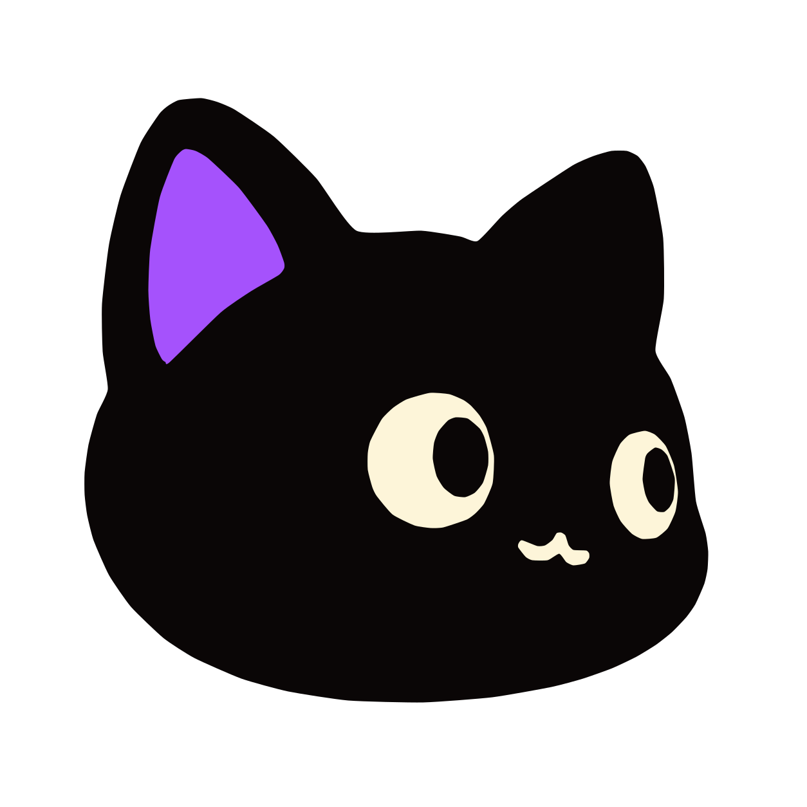

# Mahiro identity assets

[← Documentation](README.md)

Mahiro Pi’s selected character is a curious black kitten with large warm-cream eyes and one violet inner ear. Mahiro selected candidate **H2** as the identity authority and approved **J2** only as the movement and tail-language reference for production poses.

The asset pack is source artwork only. It does not replace the terminal’s authored Neko-Stack text header, activate a runtime feature or change Palace’s restrictive image policy.

## Files

The production files live under [`assets/identity/mahiro-black-cat/`](../assets/identity/mahiro-black-cat/).

| File family | Intended use |
| --- | --- |
| `mahiro-black-cat-mark.svg` | Scalable primary character mark; transparent and unrounded |
| `mahiro-black-cat-mark-{size}.png` | Deterministic transparent raster exports from 16 through 1024 px |
| `mahiro-black-cat-favicon.ico` | Multi-size 16/32/48 px favicon container |
| `mahiro-black-cat-surface-lavender-1024.png` | Opaque square for surfaces that cannot provide a light background |
| `mahiro-black-cat-mascot-sit-{size}.png` | Neutral full-body pose |
| `mahiro-black-cat-mascot-crouch-{size}.png` | Secondary playful crouch |
| `mahiro-black-cat-mascot-leap-{size}.png` | Movement pose derived from the accepted J2 direction |
| `manifest.json` | Dimensions, SHA-256 hashes, palette and derivation metadata |

## Usage

- Prefer the SVG when the surface supports it; use a PNG export only when a fixed raster size is required.
- Keep the transparent mark unrounded. The operating system or consuming product owns any circular or squircle mask.
- Use the transparent mark on warm cream, white or light lavender. Its near-black silhouette intentionally loses contrast on dark charcoal; use the provided lavender surface instead of adding an unreviewed outline or glow.
- Do not recolor the violet ear, redraw the eyes, mirror the face, add accessories or regenerate the character for convenience.
- Preserve clear space around the mark. The supplied square exports already include safe padding.
- Suggested accessible name: `Mahiro black cat character`. Decorative repetitions should use an empty alternative text.

## Palette

| Role | Color |
| --- | --- |
| Near-black silhouette | `#0A0606` |
| Violet accent | `#A552FC` |
| Warm-cream face | `#FDF5D9` |
| Lavender surface | `#DED0FD` |

## Provenance and authority

The immutable human-selected source remains H2, SHA-256 `bb6a0cfc9fef76fc668038ea210486d5e99e3ec0bc3f54d5882eb30eba486c81`. Imagegen Studio produced the selected production adaptations through receipt-bound reference calls with runtime-observed model `gpt-6.1-sol`:

- Q1 — transparent portrait and primary mark source
- R1 — neutral sitting mascot
- R2 — crouching mascot
- R3 — leaping mascot

The SVG is a deterministic contour trace of Q1’s flat color regions. The source-sized render differs from the Q1 raster at 2,917 pixels, approximately 0.186% of the square, primarily along antialiased edges. Q1 remains the raster authority when exact pixels matter.

Raw prompts, first returns, provider receipts and review boards remain outside the repository. The checked-in pack contains only selected production derivatives and its public manifest.

## Legal boundary

A bounded descriptive web search found that the broad motif “cute black cat with purple ear detail” appears in generic stock art. It did not reveal an obvious software identity matching the selected H2 combination, but this is **not** trademark clearance, a legal opinion or a claim of exclusivity. Obtain a professional image and trademark search before asserting registration or non-infringement in a commercial market.

The repository is `UNLICENSED`; inclusion of these files does not create a separate public license grant.
